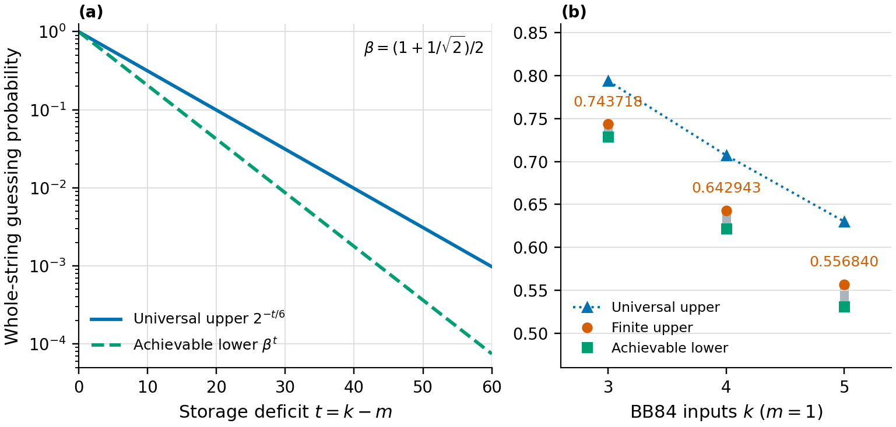

# Lattice Memory Certification

**How many qubits must a prover retain to recover a hidden string after its measurement bases are revealed?**

A receiver obtains $`k\geq1`$ independent uniform BB84 inputs before learning their preparation bases. It may process them jointly and retain unlimited classical records together with a quantum system of dimension at most $`d_Q\geq1`$. For every such encoder, the best exact whole-string recovery probability obeys

```math
p_{\mathrm{guess}}\leq\min\left\{1,\left(\frac{d_Q}{2^k}\right)^{1/6}\right\}.
```

With $`0\leq m\leq k`$ retained qubits, the exponent depends only on the missing-qubit gap $`t=k-m`$. The theorem is unconditional. Substitution into the existing LWE-based remote-state-preparation reduction of Hhan, Morimae, Okinaka and Yamakawa gives conditional classical verification with **logarithmic additive persistent-storage overhead**.

For **three inputs and one retained qubit**, an additional rank-sensitive certificate gives

```math
P^*_{3,1}\leq\frac{2+7\sqrt2}{16}
=0.7437184335\ldots,
```

with arbitrary joint encoders, basis-dependent POVMs and unrestricted classical records. The same two-copy method gives exact maximal averaged PGM scores for three, four and five inputs, and the following whole-string guessing bounds:

| Inputs, one retained qubit | Achievable guessing score | Guessing upper bound | Exact maximal PGM score |
|---:|---:|---:|---:|
| 3 | $`\beta^2=0.7285533905\ldots`$ | $`(2+7\sqrt2)/16=0.7437184335\ldots`$ | $`9/16`$ |
| 4 | $`\beta^3=0.6218592167\ldots`$ | $`(2+\sqrt{345})/32=0.6429429881\ldots`$ | $`27/64`$ |
| 5 | $`\beta^4=0.5307900429\ldots`$ | $`(4+\sqrt{4526})/128=0.5568402559\ldots`$ | $`81/256`$ |

Here $`\beta=(1+1/\sqrt2)/2`$. The achievable strategy stores one input and measures the others in the Breidbart basis. Exact PGM optimality does not determine optimal guessing. The [finite proof](science/finite-guessing.md) gives rational certificates and a limitation of the collision-only route to a better uniform exponent. The universal exponent above remains $`1/6`$.

The [direct-discrimination investigation](science/direct-discrimination.md) adds a separate analytic limitation: for a family of Hamming-ball encoders, dual bounds restricted to diagonal matrices cannot recover even the established universal decay rate. Exact primal/dual certificates also enclose optimal decoding for two specified encoders. They do not improve the global three-input bound or the uniform exponent.

## From a guessing score to processing

[Measurement-Free Memory Cost](https://github.com/GoGoKo699/Measurement-Free-Memory-Cost) supplies a dynamical application of the finite guessing theorem. A sampled noisy-storage tail factors through a Pauli algebra containing a bounded quantum system and classical information. Unconditional delayed-basis guessing success therefore enforces an expected-rank floor at every cut and gives necessary non-Clifford gate and contiguous-interval budgets in that device model.

Read the [self-contained application and boundaries](science/noisy-processing.md); the companion owns the [complete transfer proof and recovery comparison](https://github.com/GoGoKo699/Measurement-Free-Memory-Cost/blob/4b5ae9a75658bc44106b07fbb6deb2330e806df8/science/guessing_processing.md). Its notation is $`k`$ challenge qubits, $`n`$ total noisy persistent qubits and $`D`$ noise rounds. The device receives only the quantum challenge; $`X`$ stays secret and only the basis string is revealed after all charged storage. The full-output terminal envelope has $`M=2n`$, and mathematical noise flags are not supplied to the device.

This is a conditional processing witness under the specified noise, controller and gate assumptions. Existing recovery reductions imply the convenient mean-rank floors for every challenge length, including low scores. The companion's [exponential-moment theorem](https://github.com/GoGoKo699/Measurement-Free-Memory-Cost/blob/4b5ae9a75658bc44106b07fbb6deb2330e806df8/science/moment_processing.md) retains actual product-noise probabilities and gives a stronger gate and interval ledger in the same model. For a fixed positive score, its long-storage coefficient approaches that of a full logical payload as the challenge grows. The inference neither verifies those physical assumptions nor automatically extends this repository's LWE wrapper.

The [extinction-based reliability bound](science/noisy-processing.md#survival-of-the-envelope-gives-a-reliability-dependent-budget) supplies a further consequence: at fixed challenge size, nonchance score and noise strength, a width of order $`\ln D`$ requires $`\Omega(D\ln D)`$ continuing T/T-dagger gates. It controls complete loss of input dependence rather than only a rank moment. The physical premises and finite width allowance remain explicit.

## Explanatory report

Read the [complete explanatory report (PDF)](learning/report/Lattice_Memory_Certification_Report.pdf) for a self-contained explanation of the experiment, finite proof, conditional classical verification, and physical limitations.

## Principal results

| Result | Statement and scope | Authoritative account |
|---|---|---|
| Finite storage bound | $`p_{\mathrm{guess}}\leq 2^{-(k-m)/6}`$, including arbitrary collective processing and unlimited classical records | [Model](science/model.md), [proof](science/guessing-bound.md) |
| Small-challenge refinements | Exact PGM maxima $`9/16,27/64,81/256`$ for $`3,4,5`$ inputs and one retained qubit give stronger arbitrary-decoder guessing caps | [Rank-sensitive finite bounds](science/finite-guessing.md) |
| Collision-method limitation | No universal rank-sensitive PGM power strictly above $`1/3`$; this limits that proof route, while stronger joint-discrimination methods remain open | [Method obstruction](science/finite-guessing.md#5-a-limitation-of-rank-sensitive-collision-methods) |
| Direct-decoder limitation | Diagonal duals lose the established exponent on explicit Hamming-ball encoders; exact finite SDPs concern specified encoders only | [Direct discrimination](science/direct-discrimination.md) |
| Conditional LWE compilation | $`P_{\mathrm{accept}}\leq\min\{1,\eta_{\mathrm{prep}}+2^{-(k-m)/6}\}`$, for the efficient adversaries covered by the imported simulation theorem | [Certification](science/cryptographic-certification.md) |
| Logarithmic ideal gap | A store-and-Breidbart-measure strategy achieves $`\beta^{k-m}`$, where $`\beta=(1+1/\sqrt2)/2`$, fixing the overhead order with unmatched constants | [Lower bounds and resources](science/lower-bounds-and-resources.md) |
| List acceptance | Lists of size at most $`L`$ give $`P_{\mathrm{list}}\leq\min\{1,\sqrt L\,2^{-(k-m)/6}\}`$ | [Errors and losses](science/errors-and-losses.md) |
| Error and erasure boundaries | Exact recovery, tolerated errors, and pre- versus post-basis erasures have different storage guarantees | [Errors and losses](science/errors-and-losses.md) |
| Noisy-storage application | Whole-string guessing supplies rank/moment floors and an extinction-based reliability budget under the declared device model | [Noisy processing](science/noisy-processing.md) |

Given preparation simulation error at most $`\varepsilon/2`$, a total false-acceptance target $`0\lt \varepsilon\lt 1`$ is met by

```math
k=m+\left\lceil6\log_2(2/\varepsilon)\right\rceil
```

The imported construction supports this **inverse-polynomial** soundness regime with polynomially many rounds, using its nonuniform quantum-polynomial-time adversary convention for sufficiently large security parameter and polynomial output length. Efficient negligible soundness requires a corresponding preparation guarantee. Honest persistent storage is $`k`$ logical qubits; preparation, readout, communication and temporary workspace are counted separately.

## Storage deficit and finite guessing



For $`t=k-m`$, the optimal ideal success $`P^*_{k,m}`$ lies between the achieved probability $`\beta^t`$ and the universal upper bound $`2^{-t/6}`$. The right panel shows the stronger finite upper bounds for $`k=3,4,5`$ with $`m=1`$. Their PGM constants are exact; the final guessing optimum remains open. The [figure guide](verification/Graph/README.md) gives the formulas, pinned Python reproduction and the additional integer-gap overview.

## Read the science

Start with the [science guide](science/README.md), then follow the [exact model](science/model.md), [complete finite-bound proof](science/guessing-bound.md), and [cryptographic reduction](science/cryptographic-certification.md). The [related-work account](references/RELATED_WORK.md) identifies inherited ingredients and compares a specific finite specialization of the earlier uncertainty bound. The [LLM reading map](llms.txt) points directly to the same authoritative files.

The proof combines the established Barnum–Knill discrimination inequality and qubit hypercontractivity through a pure-branch rank estimate. The small-challenge refinements use two-copy purity and local-swap-sector positivity with Renes's sharper finite-alphabet discrimination inequality. Their PGM constants are tight; optimal guessing and a better all-size exponent remain open. Direct fixed-encoder SDP certificates and the diagonal-dual obstruction identify an additional limitation, without upgrading numerical encoder searches to universal bounds. The related-work account credits the inherited tools and limits the prior comparison.

## Learning route

The single educational anchor is **John Watrous, *The Theory of Quantum Information* (2018)**. Start with the [learning guide](learning/README.md), use the [Watrous bridge](learning/WATROUS_BRIDGE.md) for selected sections, notation and a complete two-qubit example, and follow the [30-milestone map](learning/MILESTONES.md).

M01–M14 assemble the foundations and storage experiment. M15–M30 develop the finite proof, achieved strategy, conditional LWE compilation, acceptance-rule limits and the noisy-storage application. Hypercontractivity, preparation and recovery inequalities are separately attributed research inputs; Watrous remains the single educational anchor shared by both repositories.

## Reproduce finite checks

With Python 3.11 or newer:

```bash
python3 -m venv .venv
.venv/bin/python -m pip install -r verification/requirements.txt
OPENBLAS_NUM_THREADS=1 .venv/bin/python verification/verify.py
OPENBLAS_NUM_THREADS=1 .venv/bin/python verification/check_learning.py
OPENBLAS_NUM_THREADS=1 .venv/bin/python verification/verify_noisy_processing.py
OPENBLAS_NUM_THREADS=1 .venv/bin/python verification/verify_finite_guessing.py
OPENBLAS_NUM_THREADS=1 .venv/bin/python verification/verify_direct_discrimination.py
```

The [verification guide](verification/README.md) documents the finite matrix checks and their [reference output](verification/expected_results.json). The [learning checks](verification/check_learning.py) cover milestone dependencies, local heading links and the worked example, with [reference output](verification/learning_results.json). The [noisy-processing checks](verification/verify_noisy_processing.py) test the quantum-plus-classical channel factorization and unconditional averaging, with [reference output](verification/noisy_processing_results.json). These finite checks complement the analytical proofs; they do not test a physical device's noise or controller assumptions. The [analytic figure](verification/Graph/README.md) has its own generator and pinned dependencies.

## Consequential boundaries

The memory budget counts **every quantum system accessible after the storage cut**, including remote ancillas. Fresh, uncorrelated decoding workspace is allowed. The basis string must be hidden until after that cut. Accepting one run is not a deterministic measurement of memory size; the conclusion is a false-acceptance bound under a specified dimension hypothesis.

The ideal mathematical converse is unconditional. The classical-verifier realization is computational and inherits its LWE and simulation assumptions. A fixed positive physical error rate is not automatically compatible with exact-string completeness; allowing a fixed fraction of wrong answers also changes the storage requirement.

## Purpose and contact

The project is currently under collaboration, and the manuscript is being written. For questions, please contact Ruge Lin at [gogoko699@gmail.com](mailto:gogoko699@gmail.com).

