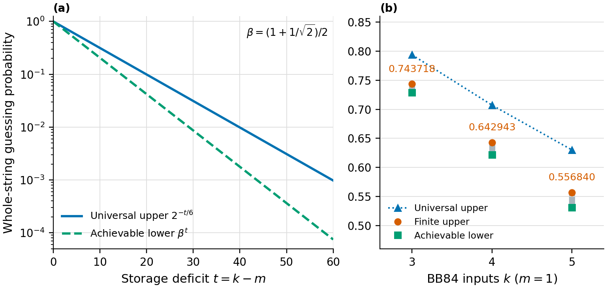

# Lattice Memory Certification

**How many qubits must a prover retain to recover a hidden string after its measurement bases are revealed?**

A receiver obtains $`k\geq1`$ independent uniform BB84 inputs before learning their preparation bases. It may process them jointly and retain unlimited classical records together with a quantum system of dimension at most $`d_Q\geq1`$. For every such encoder, the best exact whole-string recovery probability obeys

```math
p_{\mathrm{guess}}\leq\min\left\{1,\left(\frac{d_Q}{2^k}\right)^{1/6}\right\}.
```

With $`0\leq m\leq k`$ retained qubits, the exponent depends only on the missing-qubit gap $`t=k-m`$. The theorem is unconditional. Substitution into the existing LWE-based remote-state-preparation reduction of Hhan, Morimae, Okinaka and Yamakawa gives conditional classical verification with **logarithmic additive persistent-storage overhead**.

For **three inputs and one retained qubit**, the rank-sensitive certificate and its stability refinement give

```math
P^*_{3,1}\leq \frac{2+7\sqrt2}{16}-3\cdot10^{-8}
=0.7437184035\ldots,
```

with arbitrary joint encoders, basis-dependent POVMs and unrestricted classical records. The two-copy method gives exact maximal averaged pretty-good measurement (PGM) scores for three, four and five inputs:

| Inputs, one retained qubit | Achievable guessing score | Guessing upper bound | Exact maximal PGM score |
|---:|---:|---:|---:|
| 3 | $`\beta^2=0.7285533905\ldots`$ | $`(2+7\sqrt2)/16-3\cdot10^{-8}`$ | $`9/16`$ |
| 4 | $`\beta^3=0.6218592167\ldots`$ | $`(2+\sqrt{345})/32=0.6429429881\ldots`$ | $`27/64`$ |
| 5 | $`\beta^4=0.5307900429\ldots`$ | $`(4+\sqrt{4526})/128=0.5568402559\ldots`$ | $`81/256`$ |

Here $`\beta=(1+1/\sqrt2)/2`$. Storing one input and measuring the others in the Breidbart basis is optimal among pure branches with a Breidbart-diagonal marginal, as proved in the [finite guessing chapter](science/finite-guessing.md#7-exact-breidbart-diagonal-optimum-with-one-retained-qubit). The unrestricted guessing optimum and a better uniform exponent remain open.

The [direct-discrimination investigation](science/direct-discrimination.md) proves that for a family of Hamming-ball encoders, dual bounds restricted to diagonal matrices miss the established universal decay rate. Exact primal/dual certificates also enclose optimal decoding for two specified encoders.

## From a guessing score to processing

[Measurement-Free Memory Cost](https://github.com/GoGoKo699/Measurement-Free-Memory-Cost) supplies a dynamical application of the finite guessing theorem. A sampled noisy-storage tail factors through a Pauli algebra containing a bounded quantum system and classical information. Unconditional delayed-basis guessing success therefore enforces an expected-rank floor at every cut and gives necessary non-Clifford gate and contiguous-interval budgets in that device model.

Read the [self-contained application and boundaries](science/noisy-processing.md); the companion owns the [complete transfer proof and recovery comparison](https://github.com/GoGoKo699/Measurement-Free-Memory-Cost/blob/4b5ae9a75658bc44106b07fbb6deb2330e806df8/science/guessing_processing.md). Its notation is $`k`$ challenge qubits, $`n`$ total noisy persistent qubits and $`D`$ noise rounds. The device receives only the quantum challenge; $`X`$ stays secret and only the basis string is revealed after all charged storage. The full-output terminal envelope has $`M=2n`$, and mathematical noise flags are not supplied to the device.

This is a conditional processing witness under the specified noise, controller and gate assumptions. Existing recovery reductions imply the convenient mean-rank floors for every challenge length, including low scores. The companion's [exponential-moment theorem](https://github.com/GoGoKo699/Measurement-Free-Memory-Cost/blob/4b5ae9a75658bc44106b07fbb6deb2330e806df8/science/moment_processing.md) retains actual product-noise probabilities and gives a stronger gate and interval ledger in the same model. For a fixed positive score, its long-storage coefficient approaches that of a full logical payload as the challenge grows. The [extensions](science/noisy-processing.md#extensions-of-the-score-to-gate-inference) cover correlated replacement under a conditional erasure premise and an LWE verifier under a counted-memory interface and an efficient continuation.

The [extinction-based reliability bound](science/noisy-processing.md#survival-of-the-envelope-gives-a-reliability-dependent-budget) supplies a further consequence: at fixed challenge size, nonchance score and noise strength, a width of order $`\ln D`$ requires $`\Omega(D\ln D)`$ continuing T/T-dagger gates. It controls complete loss of input dependence rather than only a rank moment. The physical premises and finite width allowance remain explicit.

## Run the delayed-basis memory test

1. **Prepare the challenge.** The verifier samples independent uniform data and basis bits. For each position, initialize a qubit to zero, apply X when the data bit is one, then apply Hadamard for the X basis. Send only the qubits. Keep the data string secret and withhold the basis string until the storage cut.
2. **Store and read.** The honest prover retains all challenge qubits through the wait. After the cut the verifier sends only the basis string. Apply Hadamard on the X-basis positions, measure all qubits in the computational basis and return the ordered outcome string. The verifier accepts exactly when it equals the hidden data string.
3. **Compare with restricted storage.** The [store-and-measure witness](science/lower-bounds-and-resources.md#1-explicit-store-and-measure-witness) keeps the allowed number of qubits and measures the rest before the cut in the Breidbart basis, using a known rotation followed by computational-basis readout. After disclosure it reads the stored qubits and combines both records. Its whole-string success is the product of the per-bit successes on the measured positions. The upper bound permits arbitrary joint preprocessing and basis-dependent decoding.

For a classical verifier, the [inherited LWE preparation](science/cryptographic-certification.md#2-protocol-at-general-length) replaces the ideal source. Acceptance then requires both preparation success and the correct full string. The bound is on this joint event. Count every quantum system accessible after the cut, including remote registers. [Resource accounting](science/lower-bounds-and-resources.md#4-charged-resources) separates persistent storage from preparation, communication and temporary work. The [two-qubit example](learning/WATROUS_BRIDGE.md#a-complete-two-qubit-example) follows the ideal test.

## Principal results

| Result | Statement and scope | Authoritative account |
|---|---|---|
| Finite storage bound | $`p_{\mathrm{guess}}\leq 2^{-(k-m)/6}`$, including arbitrary collective processing and unlimited classical records | [Model](science/model.md), [proof](science/guessing-bound.md) |
| Small-challenge refinements | Exact PGM maxima $`9/16,27/64,81/256`$ for $`3,4,5`$ inputs and one retained qubit. Stability sharpens the three-input cap. | [Rank-sensitive finite bounds](science/finite-guessing.md) |
| Collision-method limitation | No universal rank-sensitive PGM power strictly above $`1/3`$; this limits that proof route, while stronger joint-discrimination methods remain open | [Method obstruction](science/finite-guessing.md#5-a-limitation-of-rank-sensitive-collision-methods) |
| Direct-decoder limitation | Diagonal duals lose the established exponent on explicit Hamming-ball encoders; exact finite SDPs concern specified encoders only | [Direct discrimination](science/direct-discrimination.md) |
| Conditional LWE compilation | $`P_{\mathrm{accept}}\leq\min\{1,\eta_{\mathrm{prep}}+2^{-(k-m)/6}\}`$, for the efficient adversaries covered by the imported simulation theorem | [Certification](science/cryptographic-certification.md) |
| Logarithmic ideal gap | A store-and-Breidbart-measure strategy achieves $`\beta^{k-m}`$, where $`\beta=(1+1/\sqrt2)/2`$, fixing the overhead order with unmatched constants | [Lower bounds and resources](science/lower-bounds-and-resources.md) |
| List acceptance | Lists of size at most $`L`$ give $`P_{\mathrm{list}}\leq\min\{1,\sqrt L\,2^{-(k-m)/6}\}`$ | [Errors and losses](science/errors-and-losses.md) |
| Error and erasure boundaries | Exact recovery, tolerated errors, and pre- versus post-basis erasures have different storage guarantees | [Errors and losses](science/errors-and-losses.md) |
| Noisy-storage application | Whole-string guessing supplies rank/moment floors and an extinction-based reliability budget under the declared device model | [Noisy processing](science/noisy-processing.md) |

Given preparation simulation error at most $`\varepsilon/2`$, a total false-acceptance target $`0\lt \varepsilon\lt 1`$ is met by

```math
k=m+\left\lceil6\log_2(2/\varepsilon)\right\rceil
```

The imported construction supports this **inverse-polynomial** soundness regime with polynomially many rounds, using its nonuniform quantum-polynomial-time adversary convention for sufficiently large security parameter and polynomial output length. Efficient negligible soundness requires a corresponding preparation guarantee. Honest persistent storage is $`k`$ logical qubits; preparation, readout, communication and temporary workspace are counted separately.

## Storage deficit and finite guessing



For $`t=k-m`$, the optimal ideal success $`P^*_{k,m}`$ lies between the achieved probability $`\beta^t`$ and the universal upper bound $`2^{-t/6}`$. The right panel shows the finite bounds directly obtained from PGM conversion for $`k=3,4,5`$ with $`m=1`$. Its three-input marker is $`C_3=(2+7\sqrt2)/16`$, before the [stability refinement](science/finite-guessing.md#8-strictness-of-the-three-input-guessing-cap). The [figure guide](verification/Graph/README.md) gives the formulas, pinned Python reproduction and the additional integer-gap overview.

## Read the science

Start with the [science guide](science/README.md), then follow the [exact model](science/model.md), [complete finite-bound proof](science/guessing-bound.md), and [cryptographic reduction](science/cryptographic-certification.md). The [related-work account](references/RELATED_WORK.md) identifies inherited ingredients and compares a specific finite specialization of the earlier uncertainty bound. The [LLM reading map](llms.txt) points directly to the same authoritative files.

The proof combines the established Barnum–Knill discrimination inequality and qubit hypercontractivity through a pure-branch rank estimate. The small-challenge refinements use two-copy purity and local-swap-sector positivity with Renes's sharper finite-alphabet discrimination inequality. Their PGM constants are tight; optimal guessing and a better all-size exponent remain open. Direct fixed-encoder SDP certificates and the diagonal-dual obstruction identify an additional limitation, without upgrading numerical encoder searches to universal bounds. The related-work account credits the inherited tools and limits the prior comparison.

## Learning route

The single educational anchor is **John Watrous, *The Theory of Quantum Information* (2018)**. Start with the [learning guide](learning/README.md), use the [Watrous bridge](learning/WATROUS_BRIDGE.md) for selected sections, notation and a complete two-qubit example, and follow the [30-milestone map](learning/MILESTONES.md).

M01–M14 assemble the foundations and storage experiment. M15–M30 develop the finite proof, achieved strategy, conditional LWE compilation, acceptance-rule limits and the noisy-storage application. Hypercontractivity, preparation and recovery inequalities are separately attributed research inputs; Watrous remains the single educational anchor shared by both repositories.

## Reproduce finite checks

With Python 3.11 or newer:

```bash
python3 -m venv .venv
.venv/bin/python -m pip install -r verification/requirements.txt
OPENBLAS_NUM_THREADS=1 .venv/bin/python verification/verify.py
OPENBLAS_NUM_THREADS=1 .venv/bin/python verification/check_learning.py
OPENBLAS_NUM_THREADS=1 .venv/bin/python verification/verify_noisy_processing.py
OPENBLAS_NUM_THREADS=1 .venv/bin/python verification/verify_finite_guessing.py
OPENBLAS_NUM_THREADS=1 .venv/bin/python verification/verify_direct_discrimination.py
```

The [verification guide](verification/README.md) documents the finite matrix checks and their [reference output](verification/expected_results.json). The [learning checks](verification/check_learning.py) cover milestone dependencies, local heading links and the worked example, with [reference output](verification/learning_results.json). The [noisy-processing checks](verification/verify_noisy_processing.py) test the quantum-plus-classical channel factorization and unconditional averaging, with [reference output](verification/noisy_processing_results.json). These finite checks complement the analytical proofs; they do not test a physical device's noise or controller assumptions. The [analytic figure](verification/Graph/README.md) has its own generator and pinned dependencies.

## Consequential boundaries

The memory budget counts **every quantum system accessible after the storage cut**, including remote ancillas. Fresh, uncorrelated decoding workspace is allowed. The basis string must be hidden until after that cut. Accepting one run is not a deterministic measurement of memory size; the conclusion is a false-acceptance bound under a specified dimension hypothesis.

The ideal mathematical converse is unconditional. The classical-verifier realization is computational and inherits its LWE and simulation assumptions. A fixed positive physical error rate is not automatically compatible with exact-string completeness; allowing a fixed fraction of wrong answers also changes the storage requirement.

## Purpose and contact

The project is currently under collaboration, and the manuscript is being written. For questions, please contact Ruge Lin at [gogoko699@gmail.com](mailto:gogoko699@gmail.com).

