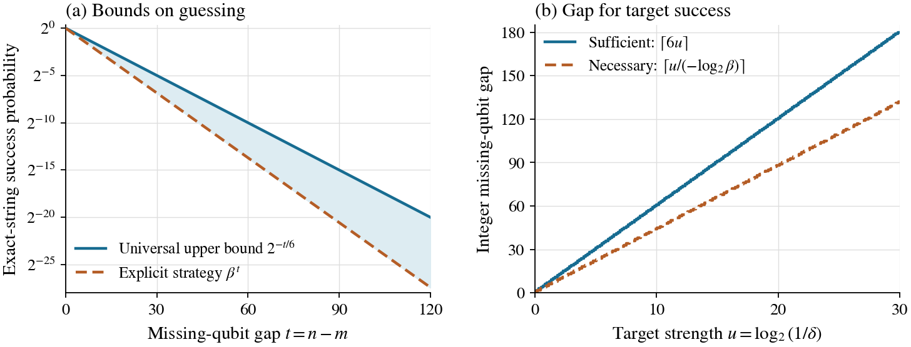

# Lattice Memory Certification

**How many qubits must a prover retain to recover a hidden string after its measurement bases are revealed?**

A receiver obtains $`n\geq1`$ independent uniform BB84 inputs before learning their preparation bases. It may process them jointly and retain unlimited classical records together with a quantum system of dimension at most $`D\geq1`$. For every such encoder, the best exact whole-string recovery probability obeys

```math
P_{\mathrm{guess}}\leq\min\left\{1,\left(\frac{D}{2^n}\right)^{1/6}\right\}.
```

With $`0\leq m\leq n`$ retained qubits, the exponent depends only on the missing-qubit gap $`t=n-m`$. The theorem is unconditional. Substitution into the existing LWE-based remote-state-preparation reduction of Hhan, Morimae, Okinaka and Yamakawa gives conditional classical verification with **logarithmic additive persistent-storage overhead**.

## Explanatory report

Read the [complete explanatory report (PDF)](learning/report/Lattice_Memory_Certification_Report.pdf) for a self-contained explanation of the experiment, finite proof, conditional classical verification, and physical limitations.

## Principal results

| Result | Statement and scope | Authoritative account |
|---|---|---|
| Finite storage bound | $`P_{\mathrm{guess}}\leq 2^{-(n-m)/6}`$, including arbitrary collective processing and unlimited classical records | [Model](science/model.md), [proof](science/guessing-bound.md) |
| Conditional LWE compilation | $`P_{\mathrm{accept}}\leq\min\{1,\varepsilon_{\mathrm{RSP}}+2^{-(n-m)/6}\}`$, for the efficient adversaries covered by the imported simulation theorem | [Certification](science/cryptographic-certification.md) |
| Logarithmic ideal gap | A store-and-Breidbart-measure strategy achieves $`\beta^{n-m}`$, where $`\beta=(1+1/\sqrt2)/2`$, fixing the overhead order with unmatched constants | [Lower bounds and resources](science/lower-bounds-and-resources.md) |
| List acceptance | Lists of size at most $`L`$ give $`P_{\mathrm{list}}\leq\min\{1,\sqrt L\,2^{-(n-m)/6}\}`$ | [Errors and losses](science/errors-and-losses.md) |
| Error and erasure boundaries | Exact recovery, tolerated errors, and pre- versus post-basis erasures have different storage guarantees | [Errors and losses](science/errors-and-losses.md) |

Given preparation simulation error at most $`\varepsilon/2`$, a total false-acceptance target $`0<\varepsilon<1`$ is met by

```math
n=m+\left\lceil6\log_2(2/\varepsilon)\right\rceil
```

The imported construction supports this **inverse-polynomial** soundness regime with polynomially many rounds, using its nonuniform quantum-polynomial-time adversary convention for sufficiently large security parameter and polynomial output length. Efficient negligible soundness requires a corresponding preparation guarantee. Honest persistent storage is $`n`$ logical qubits; preparation, readout, communication and temporary workspace are counted separately.

## Ideal exact-recovery scaling



For $`t=n-m`$, the optimal ideal success $`P^*_{n,m}`$ lies between the achieved probability $`\beta^t`$ and the universal upper bound $`2^{-t/6}`$. At ideal target $`\delta=2^{-u}\in(0,1)`$, $`\lceil u/(-\log_2\beta)\rceil`$ missing qubits are necessary and $`\lceil6u\rceil`$ suffice whenever the input length supplies that gap. The constants remain unmatched. [Figure formulas and reproduction](verification/Graph/README.md).

## Read the science

Start with the [science guide](science/README.md), then follow the [exact model](science/model.md), [complete finite-bound proof](science/guessing-bound.md), and [cryptographic reduction](science/cryptographic-certification.md). The [related-work account](references/RELATED_WORK.md) identifies inherited ingredients and compares a specific finite specialization of the earlier uncertainty bound. The [LLM reading map](llms.txt) points directly to the same authoritative files.

The proof combines the established Barnum–Knill discrimination inequality and qubit hypercontractivity through a pure-branch rank estimate. The related-work account credits earlier security at storage rates approaching one and identifies the precise finite comparison.

## Learning route

The single educational anchor is **John Watrous, *The Theory of Quantum Information* (2018)**. Start with the [learning guide](learning/README.md), use the [Watrous bridge](learning/WATROUS_BRIDGE.md) for selected sections, notation and a complete two-qubit example, and follow the [30-milestone map](learning/MILESTONES.md).

M01–M14 assemble the foundations and storage experiment. M15–M30 develop the finite proof, achieved strategy, conditional LWE compilation and physical limits. Hypercontractivity and remote preparation are separately attributed research inputs; Watrous remains the single educational anchor.

## Reproduce finite checks

With Python 3.11 or newer:

```bash
python3 -m venv .venv
.venv/bin/python -m pip install -r verification/requirements.txt
OPENBLAS_NUM_THREADS=1 .venv/bin/python verification/verify.py
OPENBLAS_NUM_THREADS=1 .venv/bin/python verification/check_learning.py
```

The [verification guide](verification/README.md) documents the finite matrix checks and their [reference output](verification/expected_results.json). The [learning checks](verification/check_learning.py) cover milestone dependencies, local heading links and the worked example, with [reference output](verification/learning_results.json). The [analytic figure](verification/Graph/README.md) has its own generator and pinned dependencies.

## Consequential boundaries

The memory budget counts **every quantum system accessible after the storage cut**, including remote ancillas. Fresh, uncorrelated decoding workspace is allowed. The basis string must be hidden until after that cut. Accepting one run is not a deterministic measurement of memory size; the conclusion is a false-acceptance bound under a specified dimension hypothesis.

The ideal mathematical converse is unconditional. The classical-verifier realization is computational and inherits its LWE and simulation assumptions. A fixed positive physical error rate is not automatically compatible with exact-string completeness; allowing a fixed fraction of wrong answers also changes the storage requirement.

## Purpose and contact

The project is currently under collaboration, and the manuscript is being written. For questions, please contact Ruge Lin at [gogoko699@gmail.com](mailto:gogoko699@gmail.com).
